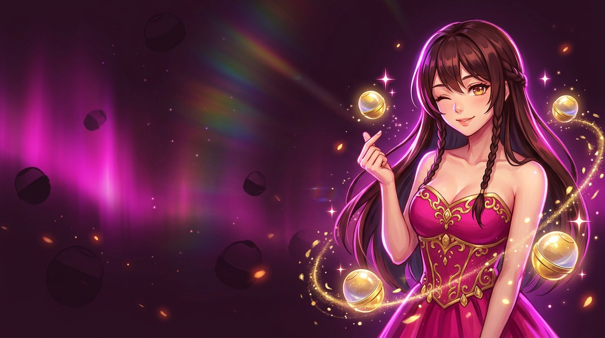
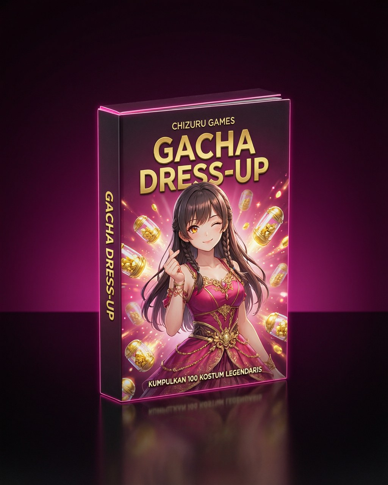
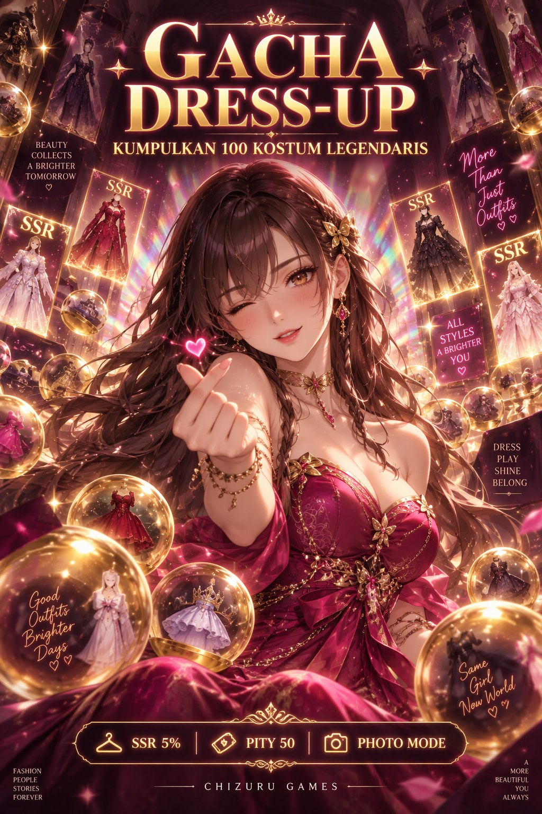
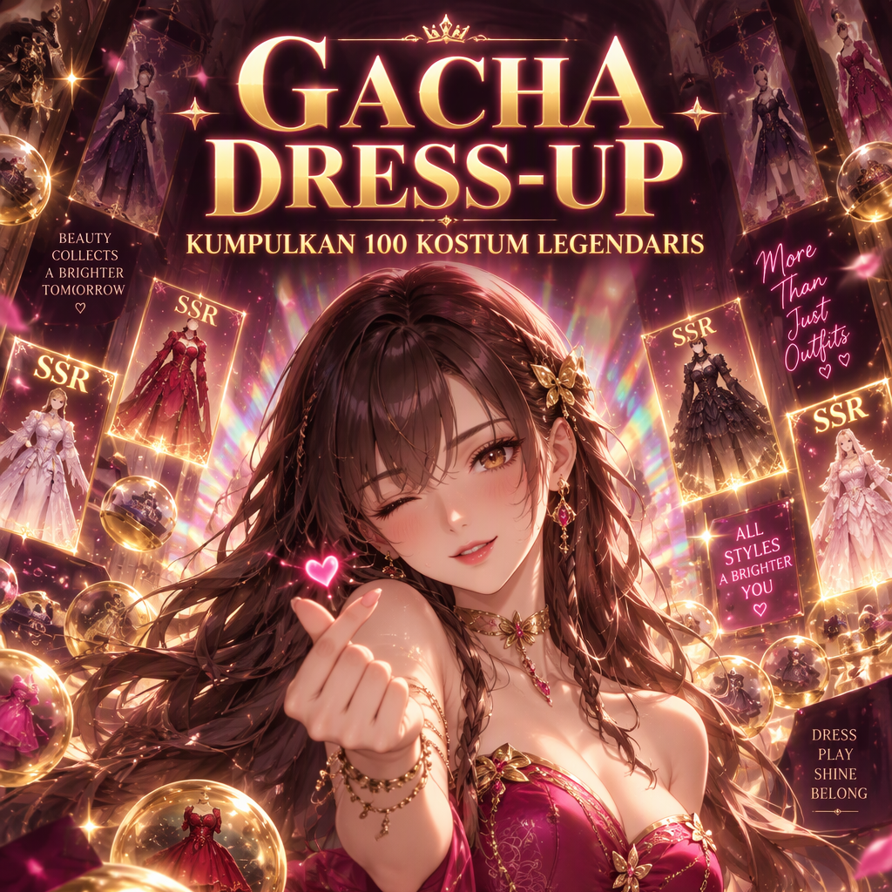

# Chizuru Gacha Dress-Up

| Software Box | Poster |
|---|---|
|  |  |

| Social Preview | Social Square |
|---|---|
|  |  |

Gacha kostum Chizuru Mizuhara: kumpulkan 100 kostum adat & olahraga, lalu foto-foto!

## Fitur (v2 "AAA")
- Summon sinematik: lingkaran mantra, orb berwarna sesuai rarity, flash + screen shake, kartu flip 3D.
- SSR: sinar emas berputar, glow pelangi, ledakan partikel, fanfare, getaran (haptics).
- Efek suara sintetis WebAudio (charge, whoosh, flip, chime rarity, koin) + tombol mute.
- Pity system: SSR dijamin pada summon ke-50, counter tampil di bar atas.
- Rate: SSR 5% (adat tribal), SR 70% (adat ikonik), R 25% (olahraga).
- Duplikat: R +20 / SR +50 / SSR +150 koin. Bonus harian +200.
- Summon x10: buka kartu satu-satu atau "Buka Semua", ringkasan BARU/SSR.
- Riwayat 60 summon terakhir + detail rate & pity.
- Album: progress %, filter rarity, badge NEW, detail kostum (asal & pose).
- Photo Mode: frame (polos/polaroid/neon/batik), filter, caption, download PNG resolusi tinggi.
- Partikel ambient melayang di seluruh layar; progres disimpan di localStorage.

## Mainkan
https://aisac-id.github.io/chizuru-gacha-dressup/

## Teknis
Static HTML + JS, tanpa server. Buka `index.html` langsung atau via GitHub Pages.
Aset gambar fan-art di `assets/`, brand & promotion kit di `promo/`.
Bagian dari suite **CHIZURU GAMES** (4 game, 100 kostum) — video promo suite ada di arsip promo kit.
